# BWMMO Prototype

一个以《宝可梦 白》为长期目标、**从 ROM 解析素材重新拼装**的联网游戏。当前版本不是完整的《白》复刻，而是一个已经跑通“原版素材 + 服务器权威联机”的垂直切片：

- **完整 Unova 室外世界**：109 个非空 overworld matrix 格子拼成 928×864 的连续战场，地形、道路、草丛、城镇和角色动画全部从本地 ROM 提取
- 室外不再有地图切换：客户端按玩家所在的 2D 格子流式加载/卸载地形；当前半径 2，会保持周围 5×5 格
- **瓦片窗口 + AOI**：服务器只下发玩家周围 65×65 的碰撞瓦片（约 4 KB，替代 830 KB 全量地图），接近边缘时用 `map_window` 重新下发局部窗口；玩家移动广播限制在半径 64 格内
- **室内场景已接入**：374 张室内地图、169 张可从室外门或室内楼梯到达。门口传送、室内出口、楼梯和当前保留的服务 NPC 来自 ROM 的 zone entities（`a/1/2/5`），进屋会保留独立 `map_state` 加载和短淡入；13 个没有可站立地面的特殊场景会跳过
- **室内 NPC 剧情对话（代码支持，当前内容已移除）**：从 `a/0/5/7` 的 16 位脚本和 `a/0/0/3` 加密文本解码真实台词，支持分页、玩家名替换，以及脚本 SetFlag 后按角色 `storyFlags` 切换后续分支；为了避免无作用 NPC 干扰，当前地图只保留治疗/商店/PC 服务 NPC
- 账号注册 / 登录 / 令牌续连
- 角色创建、三选一初始伙伴、服务器存档
- 同屏多人移动、全局聊天、聊天气泡、原版 32×32 像素小人四方向走路/跑步动画
- 治疗/商店/PC 服务 NPC 交互；碰撞、位置和交互距离由服务器裁定
- **全量 Gen 5 内容**：649 只宝可梦、559 个招式、全部升级学习表、71 个 ROM 遇敌 zone；属性克制和升级由 Showdown 结算
- **养成闭环**：320 条 Gen 5 进化关系（等级、道具、亲密度、交换等），等级达标后自动进化并保留等级/经验/招式/PP；图鉴记录 649 个编号的 Seen/Caught；满 4 招升级时进入“替换/放弃”选择而不是静默顶掉旧招；每招 PP 在战斗后写回存档，护士治疗同时回满 PP
- **战斗动画立绘**：前后立绘使用 Showdown Gen 5 动画帧表，进入战斗后循环播放待机动画；缺帧时回退到 ROM 静态图
- **原版招式特效**：559 个招式的动画脚本从 `a/0/6/6` 解码，粒子贴图/调色板从 `a/0/0/6` 提取。客户端按原版脚本的 `LoadSPA`、`PlaySPAAnimation`、`PlaySPAProjectile`、`Wait`、相机与精灵抖动命令播放撞击星、火花、火焰、心形等真实 BW 粒子；没有素材时按招式属性回退到程序特效。服务器给每个回合附带结构化 `events`，伤害、克制、异常和倒下与动画同步
- **原版战斗画面**：天空、草地和双层圆台按 BW 的四季战斗背景重绘（`batt_bg02a-d` / `batt_stage23a-d` 配色）；HP 条、名字、性别、等级、HP 数字和 EXP 条使用 ROM 字体与配色，指令层按原版组织为 FIGHT / BAG / POKéMON / RUN，再进入招式、背包或队伍子菜单
- **昼夜系统**：客户端世界时钟默认 60×（24 分钟过完一天），HUD 左上显示 `Dawn / Day / Dusk / Night` 和 `HH:MM`；天空渐变、环境光、太阳/补光以及全屏 multiply 色罩在黎明/白天/黄昏/夜晚之间连续插值，室内保持较亮；战斗场地和宝可梦立绘也同步时间色调。`--time=18:30` 指定起始时间，`--time-scale=10` 调整速度，`--real-time` 或 `--freeze-time` 切换真实/冻结时钟
- **动态世界**：室外植被使用风摆 shader，程序化天空背景遮住地图边缘，树木材质改为双面 + alpha scissor + linear mipmap；远景雾已关闭，避免白膜
- **具体地名**：无缝合众地图按 ROM 的 32×32 地图矩阵拆成 40 个区域（城镇、道路、洞穴等），HUD 训练家卡和右上角小地图显示当前格子对应的具体地名，例如诺文镇、1号道路、唐草镇；服务端在 `map_state` 和 `move_ack` 里下发按语言渲染的 `location`。
- **原版季节花树**：ROM 的花树是 `r01_a/b_spring/summer/autumn/winter` 模型替换（prop 295–302），不是 shader 变色。已提取全部季节变体并用 `seasonal_props.json` 按当前季节替换，秋季加载真正的 `r01_*_autumn` 模型；`kisetu_hana`/`hana` 小花再用色相重映射补充。默认秋季，`--season=spring|summer|autumn|winter` 可切换
- **3D 地面高度**：室外每个地图 chunk 附带从 ROM `MapHeightTile` 解码的 32×32 高度图——和 permission grid 是同一份 8 字节条目（低 2 位 shape、14 位 slope 索引、16 位平面 offset 索引，split 瓦片带两块斜面），不再从 GLB 网格采样；室内仍按 GLB 采样（室内模型自带楼层偏移）。人物、NPC 和其他玩家按脚下地形高度站立，楼梯/坡道平滑过渡；服务器在每一步移动时比较脚下高度：向上超过 24 单位（1.5 格）会被拒绝，向下最多 128 单位（8 格）允许跳下，所以不能再爬上墙体或悬崖
- **伪 3D 层次**：地形/建筑使用 ROM 烘焙顶点色 + 轻微方向明暗，3D 贴图改用线性 mipmap 过滤，接近原版柔和的 DS 观感；树底的 `ki02c`/`ki02dx`/`kage` 阴影卡片按半透明 alpha blend 渲染，不再被 alpha scissor 裁成黑块；不投实时方向光阴影，角色和 NPC 使用落地 blob shadow，相机下压到更低的俯视角；人物本身仍是原版 32×32 2D billboard。走路 4 帧/4fps、跑步 4 帧/8fps（一个步态循环含两次落脚、跨两格），移动时间与步间隔严格对齐
- 最多 6 只的队伍、战斗内换宠、药水/球道具、服务器权威回合制战斗（Showdown Gen 5 规则内核）
- **抓—养—治—买闭环**：Poké/Great/Ultra Ball 三种捕获率、Potion/Super Potion/Hyper Potion、Full Heal、Revive；诺文镇出生点南侧的 Nurse Joy 免费回满 HP 并清除异常状态；Mart Clerk 买卖道具（卖价半价）；PC 终端可存取 30 只宝可梦，存储时保留 HP/异常状态；战斗内也能用球和药，但会消耗回合
- **背包与消费**：HUD 背包按 Balls / Medicine 分页显示数量与描述，药水可直接选择队伍成员使用；战斗背包按持有的球种逐个列出，药品再选目标；金钱来自战斗胜利，商店买卖由服务器校验库存、携带上限和 NPC 距离
- 断线自动重连
- 桌面键盘 + Android 触摸操作
- 内容数据放在 JSON 文件中，带校验器和独立校验命令
- 本地 ROM 素材管线：649 只宝可梦前后立绘、24 个训练家立绘、109 个室外地图格、387 个室内场景和角色

旧的 2D 占位城镇 / 路线 / 森林仍保留在 `server/content/maps`，用于战斗、遇敌和传送的回归测试。当前主流程是完整 Unova 室外世界 + 可进入的室内场景：野外草丛会触发服务器结算的野生战斗，诺文镇的房屋和博士研究所可以从门口直接进入。

项目结构：

```
BWMMO/
├─ client/          Godot 4 客户端（GDScript）
│  └─ assets/bw/    本地提取的 BW 素材（gitignored，不上传）
├─ server/          TypeScript + Node.js 权威服务器
│  └─ content/      地图、宝可梦、招式、遇敌表（JSON）
├─ tools/rom/       ROM 素材提取工具
├─ docs/            协议与架构文档
├─ PokeMMO-Client.apk       参考用客户端（未纳入版本控制）
└─ Pokemon - White ...nds   ROM 参考文件（未纳入版本控制）
```

> 这是技术原型。请遵守版权规定，不要分发 ROM 素材或 PokeMMO 的素材/代码。

---

## 快速开始

### 环境要求

- Node.js 20+（本项目在 Node 22 上开发）
- Godot 4.4.x（项目按 4.4.1 编写；`client/project.godot` 可直接打开）
- 可选：Python 3.10+、`ndspy`、`Pillow`（仅用于从 ROM 提取本地素材）
- 无需数据库或 Docker

### 0. 提取本地 BW 素材（战斗立绘，可选）

这一步让战斗立绘、训练家立绘和 Nuvema 场景使用真正的 BW 素材。素材只在本地生成，`client/assets/bw/` 已加入 `.gitignore`，不会进入仓库。

```bash
pip install ndspy pillow
python tools/rom/extract_bw_assets.py   --rom "Pokemon - White Version (USA, Europe) (NDSi Enhanced).nds"
```

产物：

- `client/assets/bw/pokemon/<species>_front.png` / `_back.png`（649 只宝可梦的 96×96 静态战斗立绘）
- `client/assets/bw/trainers/<id>.png`（24 个 BW 训练家立绘）
- `client/assets/bw/manifest.json`

战斗待机动画单独下载并转成客户端帧表（需要网络，缓存在 `.tools/showdown_sprites`；产物仍在 gitignored 的 `client/assets/bw/`）：

```bash
python tools/fetch_battle_sprites.py
```

产物是 `client/assets/bw/pokemon_anim/<species>_front.png` / `_back.png` 和 `manifest.json`。每只宝可梦取 GIF 开头稳定的待机段，前后立绘各约 1–30 帧；没有动画数据时客户端自动回退到 ROM 静态立绘。

招式特效同样从本地 ROM 提取（动画脚本、粒子遮罩与调色板）：

```bash
python tools/rom/extract_battle_effects.py --rom "Pokemon - White Version (USA, Europe) (NDSi Enhanced).nds"
```

产物在 `client/assets/bw/battle_effects/`：`manifest.json` 保存 559 个招式的命令序列和 568 组效果索引，`effect_<id>.png` 是每组效果按原版 TPS 遮罩/调色板生成的贴图集。客户端会用原版脚本的时序和发射目标播放这些贴图；素材缺失时仍可用程序特效进入战斗。

宝可梦与训练家素材缺失时，客户端会自动回退到程序绘制占位图。请只对自己拥有的 ROM 使用，不要分发提取出的素材。

### 0.2 提取 BW 原版 UI（可选，HUD 皮肤）

HUD 的 9-slice 窗口边框和像素字体可以直接从 ROM 提取。字体是原版 NFTR 转成的 BMFont；窗口边框来自 `a/0/0/5`，几何保持原样，调色板重映射到客户端的深色 HUD：

```bash
python tools/rom/extract_bw_ui.py --rom "Pokemon - White Version (USA, Europe) (NDSi Enhanced).nds"
```

产物（同样在 gitignored 的 `client/assets/bw/` 下）：

- `client/assets/bw/ui/window_frame.png`：24×24 的 9-slice 窗口框
- `client/assets/bw/ui/bw_font.fnt` / `bw_font.png`：Godot 可直接加载的 BMFont
- `client/assets/bw/ui/items/`：原版精灵球道具图标（Poké/Great/Ultra/Master Ball）
- `client/assets/bw/ui/types/`：17 种属性的原版 32×16 类型徽章
- `client/assets/bw/ui/ui_manifest.json`：来源档案和尺寸

HUD、聊天、菜单和对话会自动使用这些素材；如果文件不存在，客户端会回退到程序绘制的深色 UI，所以没有 ROM 素材时仍可运行。聊天记录和输入框保留系统字体，以支持中文等原版字体没有的字符。

### 0.5 构建完整 Unova（默认流程，必需）

完整室外世界需要先提取所有非空地图格和角色。若暂时没有 ROM 素材，可以把
`server/content/game.json` 的 `startingMap` 改为 `"town"`，以旧的 2D 占位流程运行。
还需要 Apicula：

1. 下载 [Apicula](https://github.com/scurest/apicula/releases) 的 Windows 版本，放到 `.tools/apicula/apicula.exe`
2. 运行：

```bash
# 全量物种/招式 -> server/content/game.json
python tools/rom/extract_all_species.py
python tools/rom/extract_moves.py
(cd server && npm run build-content)
# 世界与室内
python tools/rom/extract_nuvema.py
python tools/rom/extract_unova_outdoor.py
python tools/rom/build_unova_world.py
# 室内场景素材 + 碰撞 + 门/NPC 数据
python tools/rom/extract_unova_indoor.py
python tools/rom/build_unova_indoor_worlds.py
python tools/rom/extract_zone_entities.py
python tools/rom/extract_dialogues.py
python tools/rom/build_unova_maps.py
```

仓库里已经有生成好的 `game.json`；只想重建地图时可以跳过前三行。

产物：

- `client/assets/bw/nuvema/actors/`：原版 `fmdl_hero` 系角色帧和 `actor.json`
- `client/assets/bw/unova_outdoor/`：109 个室外格的地形/道具和 `library.json`（约 51 MB）
- `server/content/maps/unova_full.json`：可玩的 928×864 完整室外地图（约 830 KB；生成源同时在 `server/content/worlds/`）
- `client/assets/bw/unova_indoor/`：387 个室内 zone 场景，5900 个房间格（约 175 MB）
- `server/content/worlds/unova_indoor.json`：室内场景碰撞数据（来自 map chunk 的 permission grid）
- `server/content/rom/species_all.json`：649 个图鉴编号的种族值、属性、捕获率和完整升级学习表
- `server/content/rom/moves.json`：559 个招式的类型、分类、威力、命中、PP 和优先度
- `server/content/rom/zone_entities.json`：427 个 zone 的 NPC、传送门、触发器
- `server/content/rom/npc_dialogues.json`：按 zone/NPC 解码出的台词、story flag 和条件分支（当前 278 个 zone、966 个 NPC profile、164 个分支）
- `server/content/maps/unova_in_<zone>.json`：374 张室内地图（169 张可从室外门/楼梯到达，含门、楼梯和当前保留的服务 NPC）

服务器把完整室外地图作为 `unova_full` 加载，出生点仍是诺文镇。客户端根据服务端下发的 `visual.chunks` 在玩家周围加载 5×5 格地形；碰撞瓦片只下发玩家周围的 65×65 窗口（约 4 KB），玩家接近窗口边缘时服务器发送 `map_window` 重新居中，不再传输整张 928×864 网格。室内使用独立 `map_state`：ROM 门洞按 warp 的完整 footprint（常见 1×3 侧门、3×1 正门）铺 `P` 瓦片，并保留原版的 `contactDirection` 作为入口方向——正面门按 W、东墙侧门按 A、西墙侧门按 D、北面门按 S，方向不符不会传送。门格本身是实心的时候，触发点铺满门前整排/整列（1×3 门就是 3 格触发）：先走上门前地板，再朝门推一次才进入（原版的两步接触）；门格本身可走的门则在方向匹配的那一步触发。刚落地的那一格会短暂失效，避免宽门洞来回弹。切换地图时客户端会短暂显示淡入遮罩。

室内 GLB 首次使用前需要导入缓存：

```bash
.tools/Godot_v4.4.1-stable_win64_console.exe --headless --path client --import
```

`run-nuvema.cmd` 仍可单独打开离线场景做素材预览；正常游戏请启动服务器和客户端，角色会直接出生在诺文镇。

### 1. 启动服务器

```bash
cd server
npm install
npm start
```

默认监听 `0.0.0.0:2567`。启动后会打印：

```
WebSocket: ws://localhost:2567
LAN (use this on your phone):
  ws://192.168.x.x:2567
Health:    http://localhost:2567/health
```

存档写入 `server/data/store.json`。可通过环境变量覆盖配置：

| 变量 | 默认值 | 说明 |
|---|---|---|
| `PORT` | `2567` | 监听端口 |
| `HOST` | `0.0.0.0` | 监听地址 |
| `DATA_DIR` | `server/data` | 存档目录 |
| `CONTENT_DIR` | `server/content` | 内容数据目录 |
| `ENCOUNTER_RATE` | 地图配置 | 强制遇敌概率（0~1，测试用；诺文镇范围没有遇敌区） |
| `TILE_WINDOW_RADIUS` | `32` | `map_state`/`map_window` 的瓦片窗口半径（65×65） |
| `TILE_WINDOW_MARGIN` | `16` | 距窗口边缘多少格时提前发送新窗口 |
| `AOI_RADIUS` | `64` | 玩家可见/移动广播的 Chebyshev 半径（格） |

### 2. 启动客户端

用 Godot 4.4.1 打开 `client/project.godot`，按 F5 运行。

Windows 下也可以直接双击根目录的 `run-server.cmd` 和 `run-client.cmd`（客户端脚本使用本项目下载到 `.tools` 的 Godot）。

或在命令行：

```bash
# Windows 示例
"C:\path\to\Godot_v4.4.1-stable_win64.exe" --path client
```

登录界面中：

1. 服务器地址填 `ws://127.0.0.1:2567`
2. 输入用户名和密码
3. 点 **Create account** 注册，或 **Log in** 登录
4. 首次进入会要求创建训练家（名字必须全服唯一）
5. 出生在 **Nuvema Town** 中央；`sprite` 决定使用原版主角/配角小人（0 Hilbert、1 Hilda、2 男孩 NPC、3 女孩 NPC）
6. 沿中央道路往北走出诺文镇，进入 **Route 1**；进入草丛会触发野生战斗

**手机/局域网测试**：手机和电脑连同一个 Wi-Fi，客户端服务器地址填服务器启动时打印的 `ws://192.168.x.x:2567`。Android 导出时需要在导出设置中勾选 `INTERNET` 权限。

### 3. 双人测试

启动服务器后，同时运行两个客户端，用不同账号注册/登录。两个角色都出生在 Nuvema Town 中央，可以立即看到对方；移动、聊天和聊天气泡会实时同步。出生点南侧保留了 Nurse Joy、Mart Clerk 和 PC 终端；纯居民/剧情 NPC 当前已从地图移除。

### 4. 自动截图演示（开发用）

服务端单独起一个测试端口（会写入独立存档）：

```bash
cd server
PORT=3567 DATA_DIR="F:/AgentProject/BWMMO/.tools/demo-data" ENCOUNTER_RATE=0 npm start
```

然后开两个终端（路径换成你的 Godot 可执行文件）：

```powershell
& ".\.tools\Godot_v4.4.1-stable_win64.exe" --path client -- --auto --server=ws://127.0.0.1:3567 --screenshot=F:/AgentProject/BWMMO/.tools/shot-a.png
& ".\.tools\Godot_v4.4.1-stable_win64.exe" --path client -- --auto-b --server=ws://127.0.0.1:3567 --screenshot=F:/AgentProject/BWMMO/.tools/shot-b.png
```

两个客户端会自动注册账号、创建角色、进入诺文镇、移动几步，然后保存截图并退出。`--touch` 可以强制显示触摸 D-pad。

其他开发用自动模式（都需要 `--screenshot=<绝对路径>`）：

| 参数 | 行为 |
|---|---|
| `--auto` / `--auto-b` | 在当前出生地图诺文镇里走动、发一句聊天后截图 |
| `--auto-run` | 用原版跑步帧在诺文镇跑一段后截图 |
| `--auto-dialogue` | 已停用（当前没有剧情 NPC） |
| `--auto-create` | 注册到创建角色界面后截图 |
| `--auto-reconnect` | 进入世界后主动断开 socket，验证 token 重连后截图 |
| `--auto-indoor` | 走进诺文镇研究所并截图 |
| `--auto-house` | 走进玩家家并截图 |
| `--auto-cliff` | 走到 Route 1 的高差/河边观察点并截图 |
| `--capture-login` | 显示登录页并截图（不连接服务器） |
| `--auto-battle` | 旧 2D 流程：需要把 `server/content/game.json` 的 `startingMap` 改回 `town` |
| `--auto-grove` | 旧 2D 流程：同样需要 `startingMap: "town"` |
| `--season=spring\|summer\|autumn\|winter` | 切换花树季节配色，默认 `autumn` |

常驻调试窗口：

```bash
./.tools/Godot_v4.4.1-stable_win64_console.exe --path client -- \
  --auto --debug-keep --server=ws://127.0.0.1:3578 \
  --debug-shot=F:/AgentProject/BWMMO/.tools/live.png
```

`--debug-keep` 走完自动路径后不退出，并把窗口拉到前台；`--debug-shot` 每 2 秒覆盖写一次当前画面，便于不开截图模式也能观察改动。

测试特定地点时可以用服务端 `DEBUG_START_X` / `DEBUG_START_Y` 覆盖新角色出生格，例如直接把角色放在 Route 1 花田：

```bash
DEBUG_START_X=786 DEBUG_START_Y=720 PORT=3579 npm start
```

---

## 操作

| 操作 | 桌面 | 触摸 |
|---|---|---|
| 移动 | `WASD` / 方向键 | 右下角 D-pad |
| 跑步 | 按住 `Shift` + 移动 | — |
| 对话 / 继续对话 | `E` / `Space` | `Talk` 按钮；对话面板可点按 |
| 打开聊天 | `T` / `Enter` | `Chat` 按钮 |
| 发送聊天 | `Enter` | 键盘 `Enter` |
| 背包 / 队伍 / 地图 / 设置 | 右下角 `Bag` / `Party` / `Map` / `Settings` | 同左 |
| 使用药水 | 打开 `Bag` → `Medicine` → 选中道具 → `USE` | 同左 |
| 商店 / PC | 走到 NPC 旁按 `E` 对话 | 走到 NPC 旁点 `Talk` |
| 关闭聊天/对话/菜单 | `Esc` | — |

游戏内 UI 支持 English 与简体中文（默认跟随系统语言）。中文使用打包的 Noto Sans SC，英文仍使用 BW 位图字体；登录界面和 `Settings → Language` 都可以切换，选择保存在 `user://settings.cfg`。服务端代码和协议字段使用英文；说明文档为中文。物种、招式、道具、地图和 NPC 名称已生成中文名；NPC 台词和服务器提示仍是英文源，尚未完成文本层翻译。

---

## 多语言

- 客户端 UI 文案在 `client/i18n/<locale>.json` 中维护，生成 Godot 使用的 PO：`python tools/build_i18n.py`。
- 运行时由 `Loc` autoload 加载 `client/i18n/*.po`，无需在编辑器中手动导入；当前发布 `en` / `zh_CN`，代码保留 `zh_TW`、`ja`、`ko` 供后续扩展。
- 客户端会在 `register` / `login` / `resume` 消息中附带 `locale`，运行中切换语言会发送 `set_locale`。
- 字体文件：`client/assets/fonts/NotoSansSC-Regular.ttf`（SIL OFL 1.1，许可证见同目录 `OFL.txt`）。新增 `ja`/`ko` 等语言前需要确认字体覆盖；当前 Noto Sans SC 不含韩文谚文。
- 内容名称由 `tools/fetch_pokeapi_zh.mjs` 生成：物种和招式从 PokeAPI GraphQL 的 `zh-hans` 名称批量获取，道具使用 PokeAPI REST，地图/NPC 名使用项目术语表。输出在 `server/content/i18n/zh_CN/names.json`，服务端按玩家 `locale` 输出。
- 当前已完成：UI 固定文案、类型/性格/状态/季节/时间标签、649 个物种名、559 个招式名、8 个道具名、地图名和 46 个 NPC 名。待完成：6366 行 NPC 台词（去重后 2279 行）、道具描述，以及服务端 notice/error/战斗日志的本地化。


---

## 当前可玩的闭环

1. 注册账号 → 三选一初始伙伴 → 创建角色 → 出生在从 ROM 拼装的 Nuvema Town
2. 另一个玩家加入 → 同屏可见 → 四方向走路/跑步动画同步
3. 服务器权威碰撞：房屋、边界和 NPC 都会阻挡
4. 全局聊天 → 头顶气泡
5. 走到出生点南侧使用 Nurse Joy / Mart Clerk / PC；纯居民和剧情 NPC 暂时从地图移除，剧情系统完成后再恢复
6. 出生点往南走到服务角：Nurse Joy 回满全队 HP、清除中毒/麻痹等异常状态并恢复全部 PP
7. 在 Mart Clerk 处用战斗赢来的金币买 Poké Ball、Great Ball、Ultra Ball 和药水；背包里可以直接对队伍成员使用药水，卖出道具返还半价
8. 在 PC 终端存取宝可梦：队伍至少保留 1 只，存储上限 30 只，存入/取出/交换都保留当前 HP 与异常状态
9. 从诺文镇沿道路一直向北，跨过格子边界时没有黑屏/传送，进入 Route 1，并可以继续探索整个 Unova 室外世界
10. 踏入任意区域配置了遇敌的草丛 → 服务器判定遇敌并下发 `battle_start`
11. 战斗指令发到服务器 → 服务器结算回合、属性克制、换宠、球种捕捉与药水 → 客户端只负责表现
12. 战斗胜利获得金币与经验，升级会提升属性并学习新招式；四招已满时会弹出替换/放弃界面，达到进化等级的物种会直接进化并更新队伍卡
13. 遇到野生宝可梦会登记图鉴 Seen，捕捉、初始伙伴和进化会登记 Caught；HUD 的 Dex 页可按全部/已见/已捕筛选并查看属性与进化条件
14. 每招剩余 PP 在战斗回合后写回角色存档，重连后继续保留；Nurse Joy 回满 HP 时也会回满 PP。战斗失败会黑屏并回到 Nuvema Town；客户端断线可用 token 恢复当前位置

> 服务角在同一屏内：从出生点向下走 7 格，Nurse Joy 在 `(783,760)`、Mart Clerk 在 `(785,760)`、PC 终端在 `(783,761)`。站在 `(784,760)` 就能同时对话/使用三者。

### 当前遇敌表（从 ROM 提取）

| 区域 | 草丛 | 宝可梦 |
|---|---|---|
| Nuvema Town / 城镇 | 无/少量 | 对应 zone 无遇敌表时不触发 |
| Route 1 及其他野外 zone | 有 | 读取各 zone 自己的 `a/1/2/6` 表；已导入全量 649 只物种 |

完整室外世界生成了 **71 个遇敌 zone**，每个区域读取自己 zone header 的 `a/1/2/6` 表。Route 1 仍是 zone 317 的第 77 号表（Patrat/Lillipup Lv2–4，各 50%）。遇敌概率目前是 10%/步，配置在 `unova_full.json` 的 `encounterZones` 中。

战斗由服务器结算，规则内核使用 **Pokémon Showdown** 的 Gen 5 模拟器（`@pkmn/sim`，MIT 许可）。速度/先制、命中、伤害、特殊/物理拆分、属性克制、STAB、暴击、能力等级、异常状态、特性和道具效果都由 Showdown 计算；我们的服务器继续负责遇敌、逃跑、捕捉概率、经验、升级、金币、存档和权威校验。捕捉使用 Gen 5 风格公式：HP 比例 × 原始捕获率 × 球加成 × 异常状态加成，再做 3 次摇球判定；客户端有投球、球落地、1–3 次摇晃和破球/捕获表现；成功捕获会直接退出战斗并弹出新宝可梦的详情卡片，不再显示战斗结算确认框。会心捕捉和暗草/捕获之力修正尚未接入。客户端只发送 `battle_action` 并显示服务器同步过来的战斗快照。详细结构见 [docs/ARCHITECTURE.md](docs/ARCHITECTURE.md#battle)。

### 物种数据（从 ROM 提取）

- `a/0/1/6` 的个人数据提供真实种族值、属性和捕获率（649 个图鉴编号）
- `a/0/1/8` 提供完整等级学习表（招式 ID + 等级）
- `a/0/2/1` + `a/0/0/2[203]` 提供 559 个招式的类型、分类、威力、命中、PP、优先度和英文名
- `a/0/0/2[70]` 提供物种英文名
- 全量数据保存在 [species_all.json](server/content/rom/species_all.json) 和 [moves.json](server/content/rom/moves.json)
- [build-game-content.ts](server/scripts/build-game-content.ts) 用 Showdown Gen 5 做 ID/名称映射并读取进化图；种族值、招式数值和学习表仍来自 ROM
- `game.json` 现在是 649 只物种 + 559 个招式；每只的升级学习表按 Showdown 可用招式过滤并去重，并带 `evolutions` 数组（共 320 条关系，含等级、道具、亲密度、交换、招式/地点条件）
- Lv5 时 Snivy 有 Tackle + Leer，Tepig 有 Tackle + Tail Whip，Oshawott 有 Tackle + Tail Whip；Lv7 学会各自的 STAB 招式，Lv17 进化为 Servine/Pignite/Dewott
- 当前只导入**基础形态**的图鉴编号；地区形态、Mega/其他战斗形态、蛋招式、TM/教学招式尚未导入
- 种族值中的 SpA/SpD 由 Showdown 用于特殊招式；`baseXp` 仍是原型奖励缩放
- 战斗招式按钮显示当前/最大 PP，0 PP 的招式会被禁用；队伍详情显示每招剩余 PP 并支持二次确认遗忘。能力等级和异常状态图标仍未显示，但这些状态已经在服务器端生效

```bash
python tools/rom/extract_all_species.py
python tools/rom/extract_moves.py
cd server && npm run build-content
```

---

## 截图

### Route 1 春季场景与战斗动画

| Route 1（风摆 + 季节植被） | Nuvema 3D 视角 | 战斗动画立绘 |
|---|---|---|
| 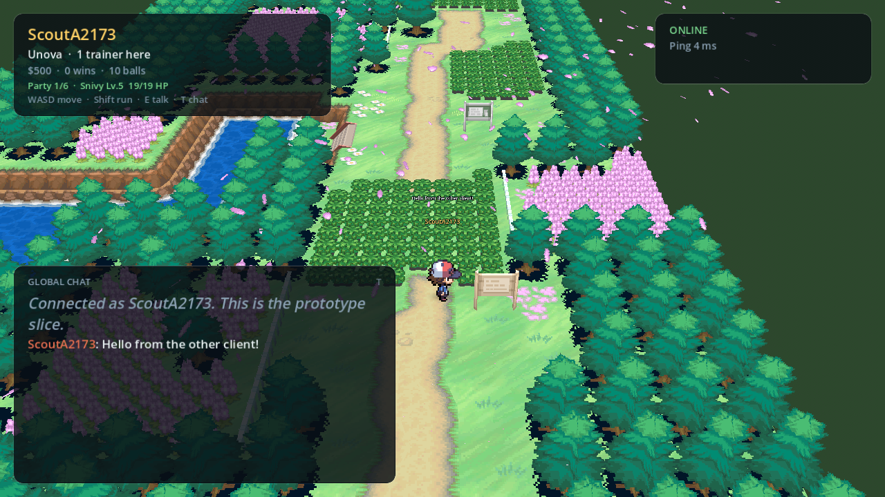 | 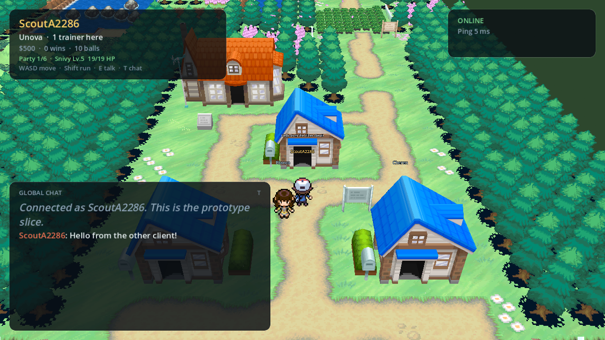 | 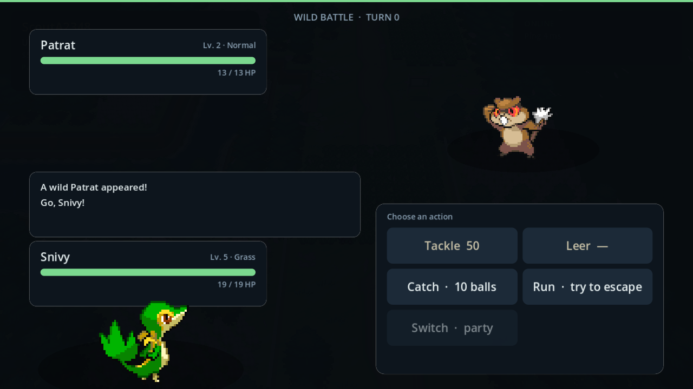 |

走路 / 跑步循环的连续截图检查：

| 走路（500ms/格，4fps） | 跑步（250ms/格，8fps） |
|---|---|
| 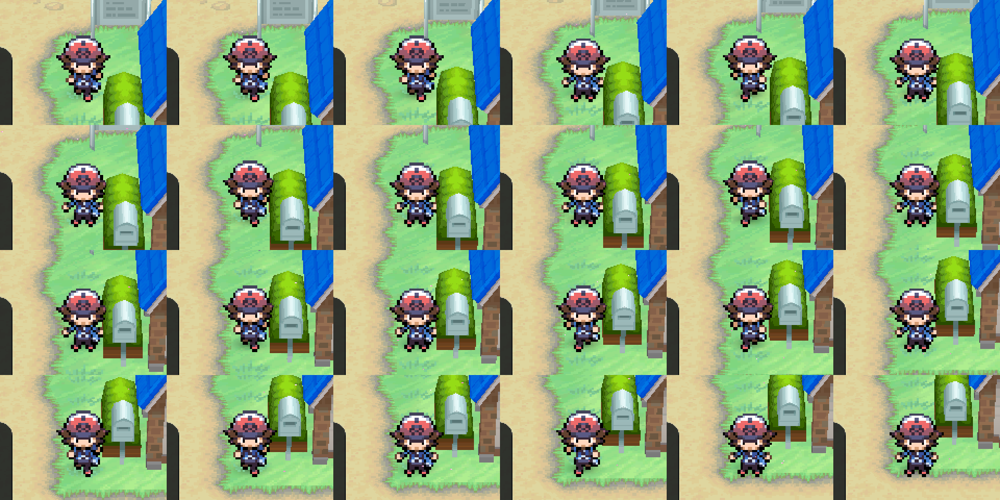 | 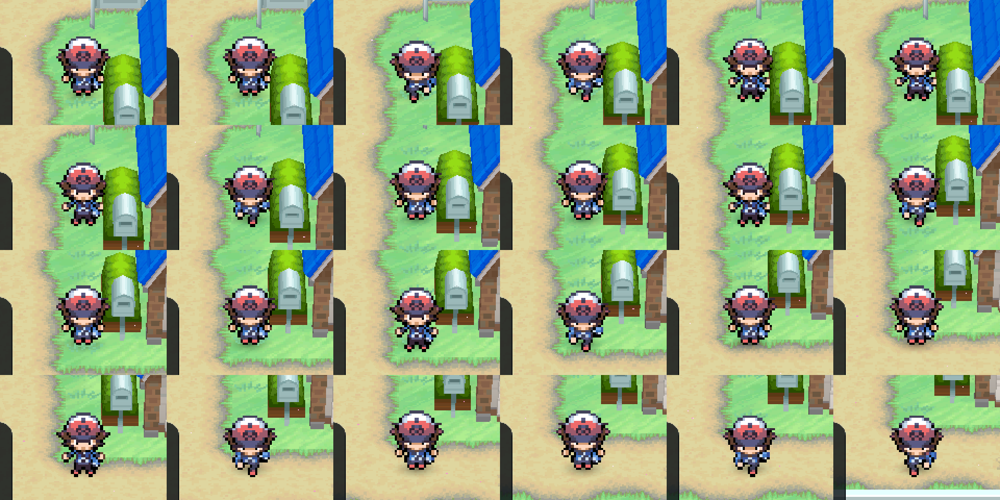 |

### Nuvema Town 在线主世界（从 ROM 拼装）

| 单人进入诺文镇 | 双人同屏 |
|---|---|
| 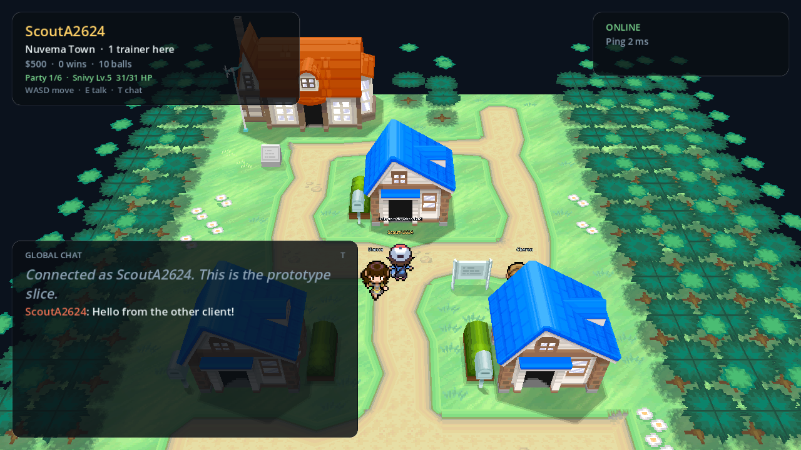 | 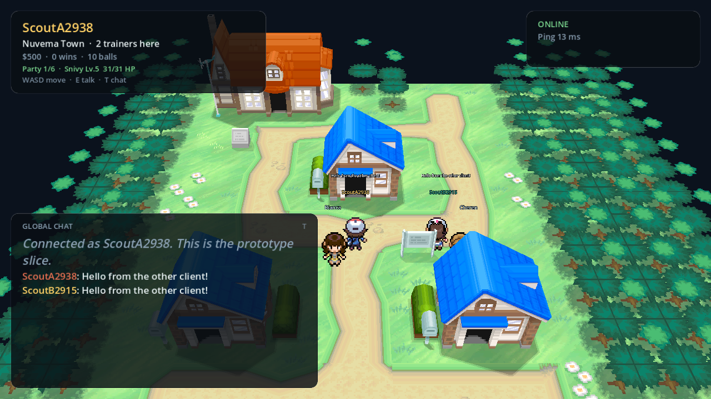 |

| 剧情 NPC 对话（当前已移除） |
|---|
| 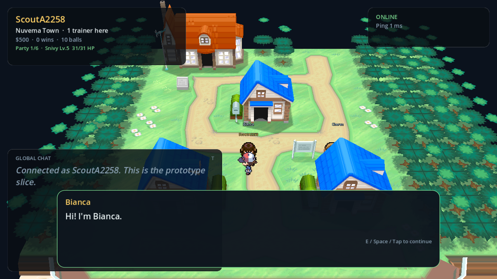 |

### 早期 2D 占位地图阶段（仍用于战斗回归测试）

| 登录 | 创建训练家 |
|---|---|
| 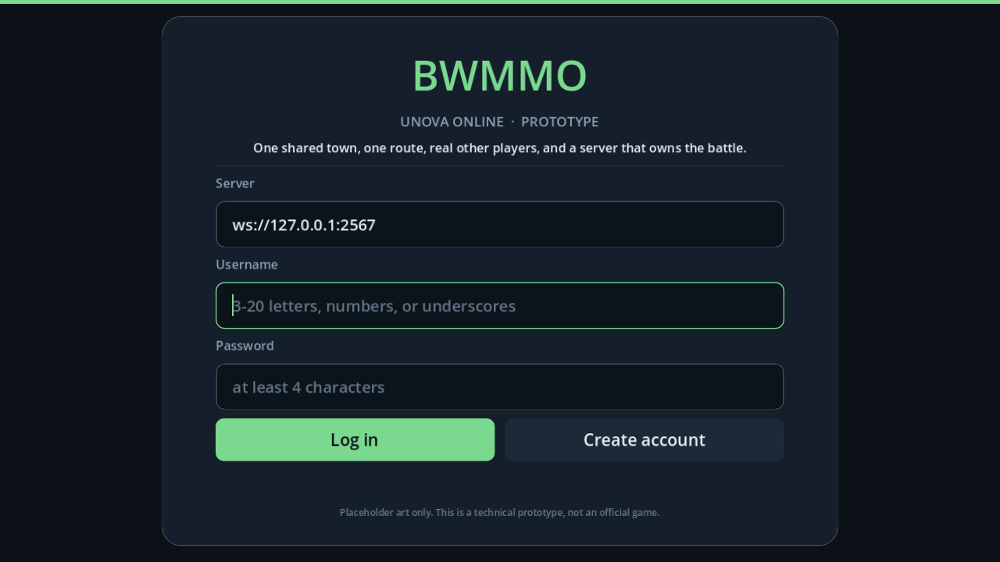 | 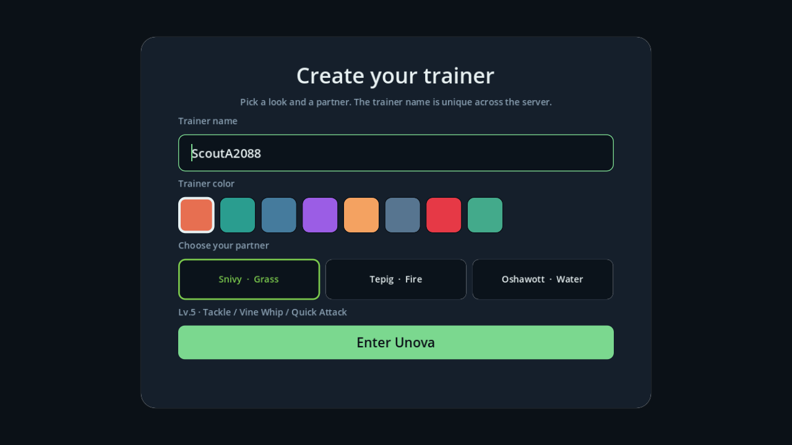 |

| 双人同屏 + 全局聊天 | 服务器结算的野生战斗 |
|---|---|
| 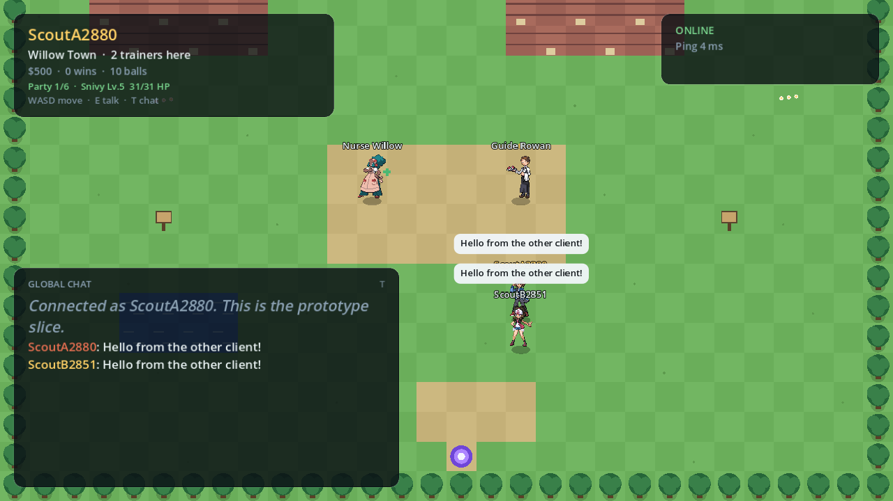 | 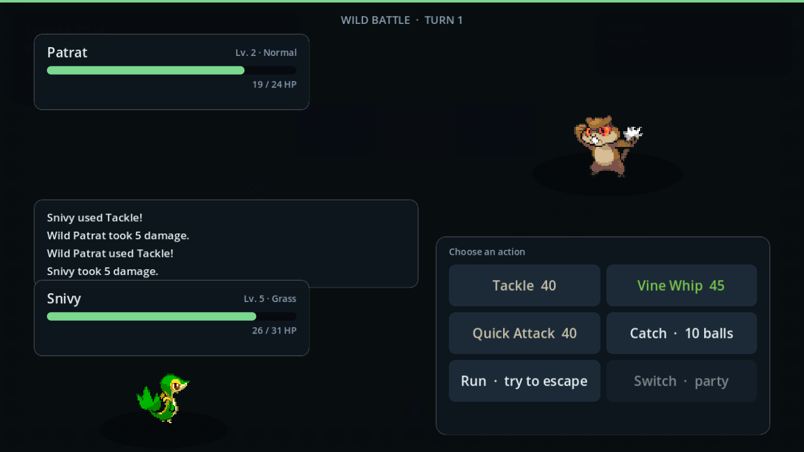 |

| Whispering Grove | NPC 对话 + 治疗 |
|---|---|
| 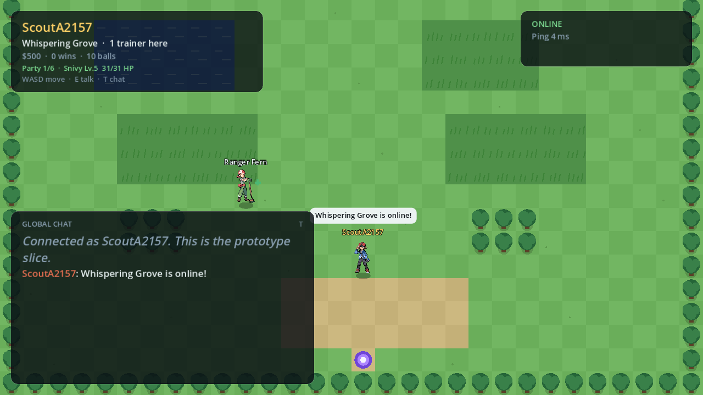 | 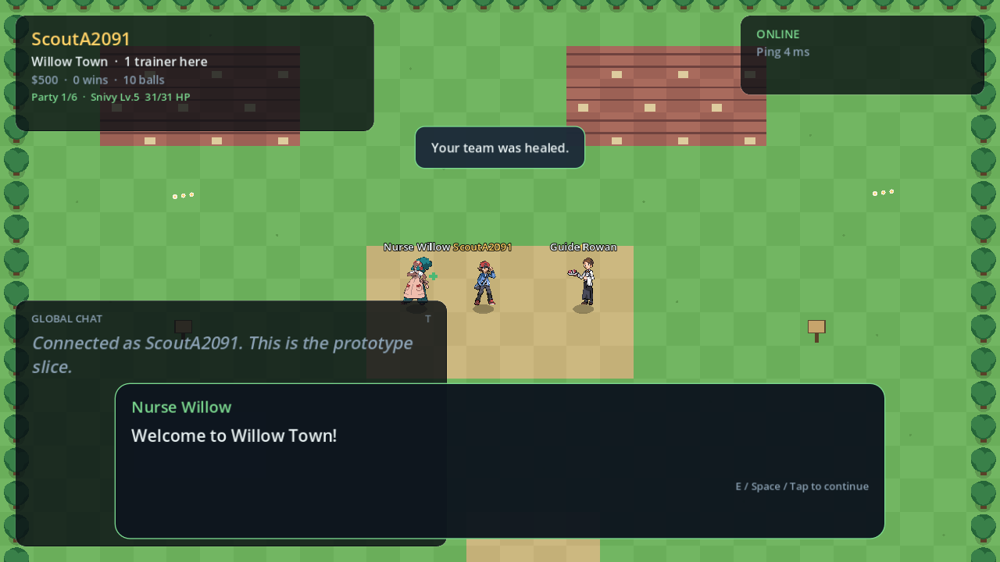 |

| 触摸控制布局 | 断线重连 |
|---|---|
| 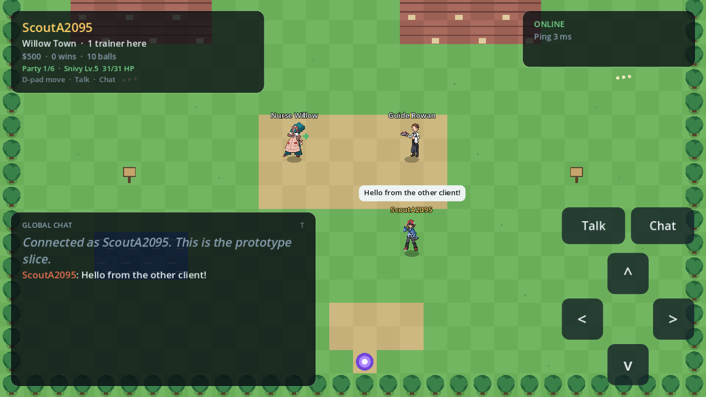 | 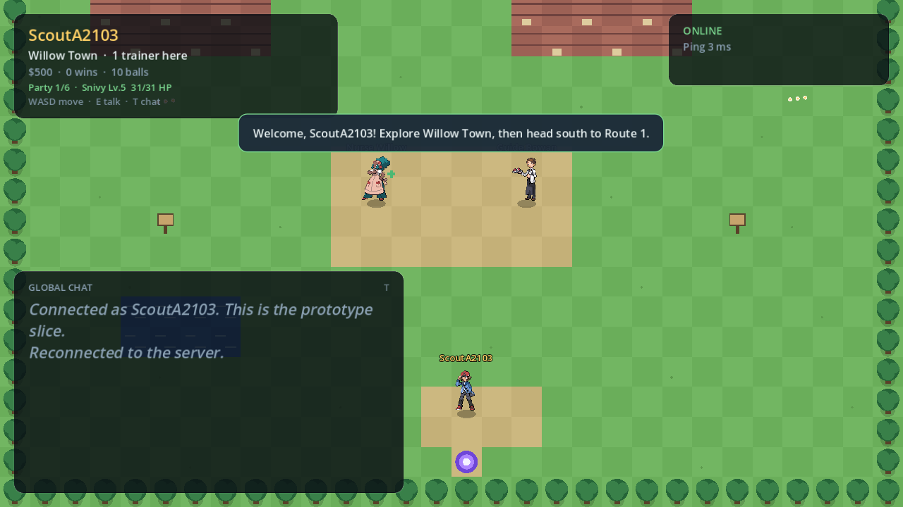 |

---

## 架构

```
Godot 4 client (GDScript)
  ├─ NuvemaOnlineView (3D, ROM GLB + AnimatedSprite3D actors)
  ├─ WorldView (legacy 2D placeholder maps)
  │  WebSocket + JSON
  ▼
Node.js + TypeScript server (authoritative)
  ├─ auth / sessions / tokens
  ├─ world (maps, collision, portals, encounters)
  ├─ battle engine (party, switching, catching, XP)
  └─ JSON store (atomic debounced writes)

server/content/*.json
  ├─ game.json (startingMap, moves, species, starters, items, shops, balance)
  └─ maps/*.json (Nuvema, Route 1 south/north, legacy 2D maps)
```

关键原则：

- **服务器权威**：位置、碰撞、遇敌、战斗结算、奖励、HP 都在服务端决定；客户端只发送意图。
- **兴趣管理**：地图瓦片只发送玩家周围的 65×65 窗口；同屏玩家和移动广播限制在半径 64 格内。
- **客户端预测 + 服务器校正**：移动立即本地表现，`move_ack` 用服务器位置纠正。
- **同一份地图数据两种表现**：服务器用 32×32 网格做碰撞，Nuvema / Route 1 客户端把网格叠加到 ROM 的 3D 地形上；2D 旧地图仍用 ASCII 瓦片渲染。
- **存档版本化**：当前是单文件 JSON；数据层已封装，后续可替换成 PostgreSQL。
- **内容驱动**：地图、NPC、招式、宝可梦、遇敌表都在 `server/content` 中，服务端启动时校验。
- **素材本地化**：ROM 提取产物只存在本机 `client/assets/bw/`，不进入仓库、不随构建分发。

更多细节见 [docs/ARCHITECTURE.md](docs/ARCHITECTURE.md)，消息格式见 [docs/PROTOCOL.md](docs/PROTOCOL.md)。

---

## 测试

```bash
cd server
npm run typecheck
npm run validate-content
npm test        # node:test 单元测试
```

端到端冒烟测试（需要第二个终端启动服务器，并强制遇敌）：

```bash
# 终端 1
cd server
PORT=3567 DATA_DIR="F:/AgentProject/BWMMO/.tools/smoke-data" ENCOUNTER_RATE=1 npm start

# 终端 2
cd server
SMOKE_URL=ws://127.0.0.1:3567 npm run smoke
```

冒烟测试覆盖：注册/角色创建、初始图鉴登记与 649 条目录下发、出生在无缝 Unova、`map_state` 只携带 65×65 瓦片窗口、双人可见、移动/跑步/原地转向广播、接近窗口边界后收到 `map_window`、聊天、Nurse Joy 治疗并清除异常、非法 PC 存入被拒绝、在 Mart 买卖药水并校验金钱、进入诺文镇博士研究所、跨越诺文镇/Route 1 接缝且不触发地图切换、草丛遇敌（只生成 Patrat/Lillipup Lv2–4）并登记 Seen、服务器结算至少一个战斗回合、战斗消耗 PP 并写回存档、token 重连后恢复世界位置/图鉴/剩余 PP、战斗后用 Potion 回复受伤的初始伙伴。

客户端离屏资源检查（无需窗口）：

```bash
.tools/Godot_v4.4.1-stable_win64.exe --headless --path client --script res://tests/check_rom_assets.gd
.tools/Godot_v4.4.1-stable_win64.exe --headless --path client --script res://tests/check_battle_animation.gd
.tools/Godot_v4.4.1-stable_win64.exe --headless --path client --script res://tests/check_battle_effects.gd
.tools/Godot_v4.4.1-stable_win64.exe --headless --path client --script res://tests/check_battle_effect_integration.gd
.tools/Godot_v4.4.1-stable_win64.exe --headless --path client --script res://tests/check_battle_layout.gd
.tools/Godot_v4.4.1-stable_win64.exe --headless --path client --script res://tests/check_hud_layout.gd
.tools/Godot_v4.4.1-stable_win64.exe --headless --path client --script res://tests/check_shop_layout.gd
.tools/Godot_v4.4.1-stable_win64.exe --headless --path client --script res://tests/check_pc_layout.gd
.tools/Godot_v4.4.1-stable_win64.exe --headless --path client --script res://tests/check_world_time.gd
.tools/Godot_v4.4.1-stable_win64.exe --headless --path client --script res://tests/check_turn_logic.gd
.tools/Godot_v4.4.1-stable_win64.exe --headless --path client --script res://tests/check_visual_runtime.gd
.tools/Godot_v4.4.1-stable_win64.exe --headless --path client --script res://tests/check_indoor_props.gd
```

`check_battle_animation.gd` 验证前后立绘帧表和帧推进；`check_battle_effects.gd` 读取原版 manifest，验证 Pound 的粒子贴图和脚本播放，并检查无素材时的属性回退；`check_battle_effect_integration.gd` 用结构化 `events` 驱动战斗 UI，验证动画期间菜单锁定、伤害事件同步更新 HP、特效结束后恢复操作，以及胜利界面等待招式动画播完；`check_battle_layout.gd` 用假战斗数据检查战斗 HUD 的字体、指令/招式/背包菜单、招式 PP 标签、球种按钮、药品目标菜单、HP 条和消息框布局；`check_hud_layout.gd` 检查背包分页、药品详情、“USE ON”按钮、图鉴筛选/分页/详情以及满四招学习弹窗；`check_shop_layout.gd` 检查商店买卖分页、金钱显示和购买请求；`check_pc_layout.gd` 检查队伍/盒子列表以及 STORE/TAKE/SWAP 请求；`check_world_time.gd` 验证时钟格式化、昼夜相位、夜间变暗和室内亮度；`check_turn_logic.gd` 验证首次按方向只转向、同方向再按才迈步；`check_visual_runtime.gd` 在 headless 下构建 Route 1 chunk，检查树/花材质 override、昼夜天空/环境光和天空环境；`check_indoor_props.gd` 构建诺文镇 Pokémon Center，断言 `pc_01`/`searock`/`c04_football` 不会作为室内 props 生成，同时保留洞穴里的 `searock`。以上都不打开窗口。

客户端静态检查（可选）：

```bash
pip install gdtoolkit
python -m gdtoolkit.linter client/scripts/*.gd
```

---

## 当前限制（有意为之）

- 完整室外 Unova 已拼接为 109 个格子/928×864 网格；地图瓦片按 65×65 窗口下发（约 4 KB），但 `map_window` 仍是整窗重发而不是差分，AOI 也是每次移动线性扫描玩家列表，没有空间索引
- 玩家广播半径固定为 64 格（`AOI_RADIUS`）；视野外的玩家不会互相收到移动消息，也还没有分线/channel
- 387 个室内场景中 374 个已生成地图（13 个 permission grid 无可站立地面而跳过）；从室外出生点出发可到达 169 张，129 个室外门（门前共 197 个触发格）已连通。少数门/电梯/剧情传送因为目标场景特殊或坐标被阻挡而暂时跳过
- 室内 NPC 对话已从 `a/0/5/7` 脚本和 `a/0/0/3` 文本解码；当前约 47% 的室内 NPC 实体有可用 profile，其余是特殊/全局脚本、无文本 NPC 或遇到未解码命令，仍回退到通用对话
- 训练家事件、完整剧情触发器、`a/0/5/7` 的全部高号命令和剧情 flag 初始化还没有接入；当前 story flag 只由 NPC 对话脚本的 SetFlag 写入
- 室外和室内碰撞与地面高度都来自 permission grid（`a/0/0/8`）的 8 字节条目：高 16 位决定可走性，低 16 位的 shape/slope/offset 决定该格的地形平面；服务器移动时再做逐格上下坡判定（向上 24 单位上限、向下 128 单位上限），客户端预测使用同一规则。这比生成时永久封边更接近原版“跳下矮台、不能爬墙”，建筑/道具 footprint 和跨格接缝仍需视觉抽查
- 战斗待机动画使用 Showdown Gen 5 GIF 转帧表，不是直接解析 ROM 的 NCER/NANR；闪光、替身和全部形态动画尚未覆盖
- 招式特效的**选择、时序、目标侧、投射物路径和精灵抖动**来自 ROM 的 559 份动画脚本与 `a/0/0/6` 粒子贴图，但原版粒子是 3D billboard + APS 发射器；当前客户端用 2D 贴图近似，尚未解析 APS 粒子图（多个发射器共享一张贴图时按序号循环映射），也还没有接入招式音效和招式背景（`LoadBackground`）。部分 `CheckMoveUser` 分支和 3D 旋转参数被忽略
- Route 1 原版的季节性飞舞落叶尚未复刻；客户端此前自制的 MultiMesh 叶片实现因生成位置跟随角色而出现“人走到哪生成到哪”的 bug，已删除脚本、贴图和测试。树/花材质修正、风摆和天空背景已接入；远景雾曾因相机距离过远产生白膜，现已关闭。已带窗口复核诺文镇、Route 1、研究所和玩家家；其他城市/洞穴仍需逐区域抽查
- 人物仍是原版 32×32 2D billboard，不是 3D 骨骼/模型；3D 层次来自逐格地形高度、烘焙明暗、线性贴图过滤和相机角度。走路 4 帧/4fps（500ms/格），跑步 4 帧/8fps（250ms/格），一个步态循环含两次落脚、跨两格，连续移动有 80ms idle 缓冲避免每步闪回站姿
- 地形/建筑/植被使用 ROM 烘焙顶点色和线性 mipmap，不投射实时方向光阴影；角色使用 blob shadow。这是为了贴近原版 BW 的烘焙光照，不追求 PBR/全局光照/SSAO
- 室内使用更近、更高的相机预设；小房间会自动取可走区域中心，再向玩家偏移 35%，并隐藏室内 chunk 携带的 `buill_*`/`thouse_*` 建筑外壳 props，以及 Pokémon Center 房间里的 `pc_01` 建筑外壳、`c04_football` 测试场地和 `searock` 镇外岩石。部分房间仍有黑边和墙体遮挡，需要逐场景微调
- NPC 名字标签按距离淡出，玩家自己的头顶名字隐藏；聊天栏 12 秒无活动会自动折叠成一条窄栏，点击 `+` 或按 T 可重新展开
- 目前已启用 FXAA；GL Compatibility 下测试 MSAA 会导致曝光/阴影异常，所以 MSAA 保持关闭，后续如果要更强抗锯齿需要评估 Forward+/Mobile 渲染器
- 旧 2D 地图仍在，用于战斗、遇敌和传送的回归测试，不在默认出生流程内
- 其他 2D 地图仍使用 BW 训练家战斗立绘缩放成头像；完整 Unova 室外使用原版 32×32 场景小人
- 全量内容目前只覆盖基础形态的图鉴编号；地区形态、Mega/其他战斗形态、蛋招式、TM/教学招式尚未导入
- 进化图已导入 320 条关系，但当前只会自动触发等级与“升级时已掌握指定招式”两类；道具、交换、亲密度和特殊地点进化只用于图鉴提示，尚无对应触发界面。没有 Move Reminder/TM，遗忘的升级招式不能重新学习
- 道具经济是原型规模：只有诺文镇一家商店、8 种道具、携带上限 99；没有徽章/剧情门槛、持有物、训练家对战、双打、PvP、交易或市场
- PC 目前只有取出/存入/交换，没有放生、改名、多盒子分类和排序
- 战斗内使用药品会固定消耗一个回合；没有战斗内换人时的药品提示、批量购买确认或撤销购买
- 没有完整的 BW 剧情、任务/事件脚本；季节目前是客户端 `--season=` 选择 + `r01` 模型替换/小花重映射，还没有全局季节状态、ROM 季节事件或服务器日期同步
- 没有分线/分片；AOI 只是单进程内的距离过滤，当前按“小规模世界”设计
- 没有生产级反作弊、审计、限流集群
- 存档是 JSON 文件，不是 PostgreSQL
- Android 导出预设未提交（需要本机 Android SDK + 导出模板；在导出设置里添加 INTERNET 权限）
- 中文 UI 字体和物种/招式/道具/地图/NPC 名称已接入；NPC 台词、道具描述和服务器提示仍未翻译，服务端 notice/error/战斗日志也还没有按 `locale` 渲染

## 下一步路线

> P0 全量内容已完成：649 个图鉴编号、559 个招式、完整升级学习表、320 条进化关系、71 个遇敌 zone、649 组前后立绘。

1. **室内覆盖补全**：处理剩余 13 个空碰撞场景、被阻挡/剧情用的门，并逐个抽查洞穴、电梯和大型建筑
2. **AOI 与分线**：把半径线性扫描换成网格/四叉树索引，把 `map_window` 改成差分更新，并加入地图分线（channels）和更多相邻格的预加载圈
3. **剧情与事件**：NPC 对话已解码；继续补齐 `a/0/5/7` 的高号命令、剧情 trigger/flag 初始化、训练家遭遇和剧情传送
4. **室内体验**：按房间调整镜头距离，逐个检查门口朝向、传送落点和大型洞穴的镜头遮挡
5. **继续拼装更多 ROM 场景**：把室内/室外构建器扩展成通用 zone 管线，并补齐洞穴、桥梁和特殊地形
6. **养成扩展**：道具/亲密度/交换进化、Move Reminder/TM、PP 恢复道具、昵称与放生
7. **战斗扩展**：持有物、能力等级与异常状态图标、训练家对战、双打、更聪明的 AI
8. **商店与 PC 扩展**：更多城镇商店、徽章门槛、道具分类/多盒子、批量整理
9. **MMO 层**：分线、交易、PvP、市场、好友、公会
9. **生产化**：PostgreSQL + Redis、战斗回放/审计、反作弊、可观测性

## 版权说明

本项目用于局域网内部的个人学习与原型验证。战斗规则使用 MIT 许可的 [Pokémon Showdown](https://github.com/smogon/pokemon-showdown) `@pkmn/sim`；宝可梦数据与 IP 权利仍属于原权利人。项目不会对外发布，`PokeMMO-Client.apk`、NDS ROM 和从 ROM 解码的剧情文本仅在本机使用。
