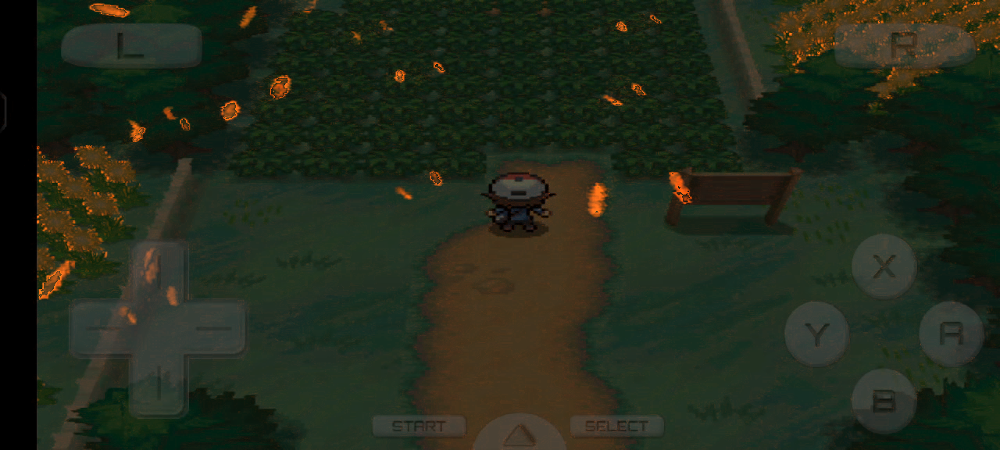
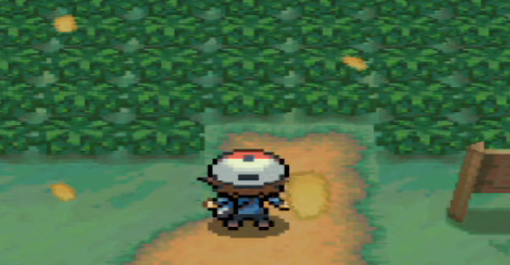
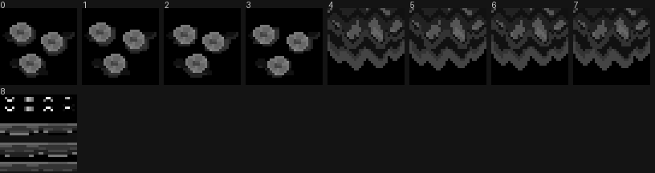
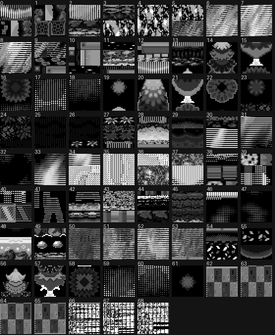

# Route 1 飞舞叶片：资源考证与实现路径

调查对象是 `BW Route1.mp4`（1280×576，30 fps，6.49 s，195 帧；秋季 Route 1，树下飘落的橙色叶片）。
所有结论都按**内容**（文件头、字符串、解出的像素）确认，没有靠资源编号推断。

## 一句话结论

空中的叶片不是贴图精灵，而是**3D 世界里的朝向相机四边形（billboard）**，颜色平涂、随季节换色；
季节本身在 BW 里是**整包资源替换**（换模型、换地图贴图），不是运行时染色。
全 ROM 没有任何"叶片形状"的 2D 精灵，这一点是可以证明的负面结果。
叶片的发射器/参数表是本轮**唯一没有定位到**的部分，候选已缩小到 `a/0/6/1` 与 `a/0/6/2`。

## 1. 视频里实际看到的东西

先量再猜。把视频按帧拆开、对同机位两帧（0.5 s 与 0.8 s）做逐像素差分，得到的就是运动物体图（`img/leaf_motion_map.png`）：
背景灌木与地形完全不亮，只有叶片亮起来，说明镜头静止、叶片是独立运动体。

同屏大约 20–30 片。远处叶片约 22×16 视频像素，近处可达 50 像素，按主角 32 px 贴图在画面里占约 66 px 换算
（放大倍数 ≈2），也就是**远处约 8×11 DS 像素、近处约 25 DS 像素**——尺寸随距离变化，是典型的透视缩放，
所以它们有真实的 3D 坐标，不是屏幕空间粒子。

遮挡关系也一致：叶片会被长椅和灌木挡住，也会飘到主角前面和身后，说明它们参与深度排序。

颜色上，叶片内部几乎是纯色。取两片叶子的核心像素，均值分别是 (191,162,81) 和 (194,165,77)，
核心区标准差只有 4–7，折算成 BGR555 约 **0x2A97**（R=23, G=20, B=10，暖金色）。
换句话说，在 DS 分辨率下这片叶子**没有叶脉、没有明暗渐变**，就是一个平涂小面片；
视频里看到的柔和边缘来自模拟器的放大滤波，不是资源本身的 alpha 渐变（DS 的 3D 只有 1-bit alpha）。

同一帧 3 倍放大的特写（上图）。画面里那个大而软的黄色圆斑不是叶片，
它没有位移、贴在路面上，属于地图的光斑贴片（贴图名 `d2_hikari01`，见第 3 节）。

## 2. 季节是怎么实现的（按内容确认）

BW 的季节不是给整张地图调色，而是**换资源**。能按名字确认的有三类。

第一类是地图道具整模型替换。`a/0/0/0` 的 295–302 号就是 `r01_a`/`r01_b` 的春/夏/秋/冬四套，
项目里的 `extract_seasonal_props.py` 已经在用；同类证据还有 `a/0/7/5` 里的
`short_grass_sp/su/au/wi`、`long_grass_sp/su/au/wi`，以及 `a/1/6/0` 里的
`f_wheel_01au/sp/su/wi`、`intro_town03au/sp/su/wi`。

第二类是**同一张贴图的四个季节版本**。`a/0/7/0` 只有 6 个条目，每个都是 BTX0：
里面的贴图一律带 `.1` `.2` `.3` `.4` 后缀——`kisetu01.1–.4`、`mori01ca.1–.4`、`sea_simi.1–.4`、
`sea_kira.1–.3`、`taki_shibu.1–.4`、`fire.1–.4`、`denki.1–.4`。
把 `a/0/7/0` 第 2 个条目按 32×32、4bpp 线性切分后（下图，索引灰度图，调色板尚未解出），
前四块是同一朵"三朵小花/三片叶子围成一圈"的图案的四个变体，接下来四块是同一张波浪状林地图案的四个变体。
这就是"季节 1–4"最直接的证据：**一个文件里并排放着四个版本，运行时按当前季节选一个**。

第三类是地图贴图库本身带的季节贴图。`a/0/1/4` 有 282 个 BTX0（每张地图一套），
几乎每套户外图里都能看到 `kisetu_hana`（季节花）、`kisetu_yuki`（季节雪）、
`mori01a`/`mori01s`、`ki02ax`/`ki02bx`/`ki02cx`/`ki02dx`、`kusa_ec1`/`kusa_ec1s`/`kusa_ec2`/`kusa_ec2s`，
同一素材带不同尾缀，配合上面的结论，尾缀就是季节/状态变体。

所以：**秋天看到橙色，是因为树、草、地面贴片都换成了秋季那一份，不是因为有个染色 shader**。
这也和现有客户端一致——README 里已经写明只有 `kisetu_hana`/`hana` 这类小花用色相 shader 做补充。

## 3. 叶片贴图：找到了什么，没找到什么

先说**名字里带 leaf 的都在哪**，以及它们为什么都不是这个效果：

| 资源 | 名字 | 实际是什么 |
| --- | --- | --- |
| `a/0/4/7` #27、#33 | `konoha02/03/06/08/09/10`、`leaf01/02`、`happa01/02` | Pokémon Musical 舞台布景贴图。同档案里还有 `mus_stage01–05`、`flower`、`komorebi`（树影），是平面舞台画，不是野外粒子 |
| `a/0/0/4` #873、#893、#44/#64、#53/#73 | `leaf1–leaf5`、`leaf_a/b/c/d`、`leaf_f/l/r` 等 | 宝可梦战斗贴图的部件名（藤藤蛇一系的叶片），属于精灵图集 |
| `a/0/1/4` #106 等 | `d2_leaf_r`、`d2michi_ha`、`bc_ha01` | 地图贴图库里的落叶/草丛贴片 |
| `a/0/0/8` #288 | `d2_leaf_r` 出现在 `polySurface755` 网格的材质里 | 地图 chunk 自带的落叶几何（贴地），不是空中的粒子 |

`a/0/1/4` #106 解出来的贴图见下图：能认出树（第 12–15 块，树干加圆形树冠）、
灌木（第 22、23 块）、草丛、岩石，全是地形素材。`d2_leaf_r` 就在这一套里。

然后是**负面结果**，这个更重要：我把 235 个 NARC 里所有能解出合法 NCGR 头的贴图都解了一遍，
每张配 1–8 组最近 NCLR 调色板，按"橙色像素占比"打分，全库只有 10 个命中，逐张看过都是噪声。
也就是说 ROM 里**没有一张橙色叶片形状的 2D 精灵**（NCGR/NCLR），也没有对应的 NCER/NANR 帧序列。
这与第 1 节的像素测量互相印证：效果不需要叶片贴图。

## 3.5 叶片是不是 Route 1 的地图资产？（直接核对过）

有人会自然地猜：叶片会不会像树、草、水一样，本来就是 Route 1 模型的一部分，只是引擎在用算法让它们动。
把 Route 1 的 chunk 直接从 `a/0/0/8` 取出来核对，结论是否定的。

Route 1 三个 cell 对应 `a/0/0/8` 的第 2/3/4 个 chunk（cell 23,22 / 24,22 / 24,21）。LZ11 解压后，
每个 chunk 恰好只有四段，没有第五段可以藏发射器：

| chunk | 头部 | BMD0 | permission | prop 实例表 |
| --- | --- | --- | --- | --- |
| model 3（24,22 南） | 0x14 | 0x14–0x64B0（25,756 B） | 0x64B0–0x84FC | 0x84FC–0x8530（3 个） |
| model 4（24,21 北） | 0x14 | 0x14–0x3BA0（15,244 B） | 0x3BA0–0x5BA4 | 0x5BA4–0x5BC8（2 个） |

prop 表里也没有"叶片/发射器"这类道具：南 cell 是 `sign01`、`sign04`、`r01_a`，北 cell 是 `sign04`、`r01_b`。

BMD0 里只有 MDL0 一个子段，**没有 SBC0（billboard 节点），也没有 SRT0/SRT1 动画**；
材质南 22 个、北 15 个，全部是地形贴图——
`gake01a`、`gake1_1`、`grass01ax`、`hana01_1`、`kaidan01a`、`ki02ax`、`ki02bx`、`ki02c`、`ki02dx`、
`kusa_ec1/2/3`、`michi01a/b`、`michi_isi`、`saku01a`、`sea_gake01/02`、`sea_mizu1`、`ue_grass00/01`。
季节树 prop `r01_a_spring` / `r01_b_spring` 自己也只有 4 个静态 mesh（`r01_sp_01/02/04/05`），同样没有 billboard 或动画。

最直观的一条：同一份 BMD 已经转成 GLB 放进客户端了，里面就是 1 个 mesh、22 个材质。
如果叶片是地图几何，它现在就应该已经跟着地形一起显示出来，不需要任何额外代码。

所以：**叶片不是 Route 1 的模型资产**，它是运行时生成的世界空间面片（朝向相机、参与深度测试、按季节换参数）。
还确定不了的是"哪些 zone 会启用它"——发射器表（`a/0/6/1`、`a/0/6/2` 的 52 字节记录）字段含义未解，
所以客户端目前按"室外 + 非冬季"统一开启；要精确到地图，得先解开那张表。

## 4. 这个效果在引擎里是怎么拼出来的

综合上面的证据，能还原出的结构是：

每个叶片是一个 3D 世界里的小四边形，每帧朝向相机，参与深度排序，颜色是平涂的暖金色（秋）。
它们在以相机为中心的盒状体积里持续生成，一边横向漂移一边缓慢下落、自转，离开视野后回收；
同屏维持 20–30 个。因为尺寸随距离缩放、且只有 1-bit alpha，最终在 DS 分辨率下就是一个几像素的实心小片。
颜色不来自贴图，而来自按季节切换的参数，这也解释了为什么换成夏天后同一效果会变成绿色。

至于发射器本身写在哪儿：`a/0/6/6` 是 601 个招式脚本（前 559 个对应招式），`a/0/6/9` 是 29 个
BTA0/SRT0 的贴图 UV 动画（`area_ita_00`、`d0_mizgiwa`、`d0sizuku`、`bc_ha01` 等，全是水面/光斑/瀑布的板动画），
`a/0/6/3` 是 2D 单元动画合集（单元名 `hatena`、`clear`、`CellAnime4–7`，画面是界面用的箭头和面板，
不是叶子）。这些都排除了。剩下形状最像"环境效果参数表"的是 `a/0/6/1`（56 个）和 `a/0/6/2`（10 个）：
每个文件 780 字节，正好是 15 条 52 字节记录，每条记录前 4 字节是标志，后面 24 个 u16 里既有 BGR555 颜色
（`0x7FFF` 白、`0x41CE` 之类）又有 `0x1000` 这种定点 1.0 参数。`a/0/6/1` 里 56 个条目只有 23 种不同内容，
其中 44–47、48–51、52–55 是连续四份相同的数据——四份一组的组织形式，和季节的分组习惯一致。
但每个字段的含义还没定下来，所以**不能**断言它就是叶片发射器。

## 5. Godot 客户端里的实现（已移除）

客户端曾用 `season_leaves.gd` 的 MultiMesh billboard 近似这套效果，但叶片生成位置跟随角色，出现“人走到哪生成到哪”的明显 bug。该实现已从客户端删除：脚本、测试、贴图和生成工具都已移除。上面的 ROM 考证保留，供以后按正确的发射器/世界坐标重新实现时参考。

## 6. 还没解出来的部分

一是发射器定义（`a/0/6/1`、`a/0/6/2` 的 52 字节记录字段）。二是 BTX0 的贴图信息表里
宽高/偏移字段还没完全定死（见 `tools/rom/README.md` 新增的 TEX0 一节，数据区偏移和 32×32 切分已经可用）。
这两块补上之后，就能确认叶片颜色到底是从哪张表读的。
